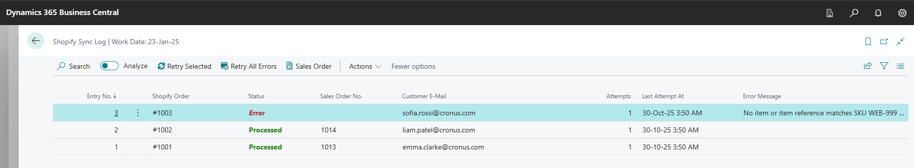
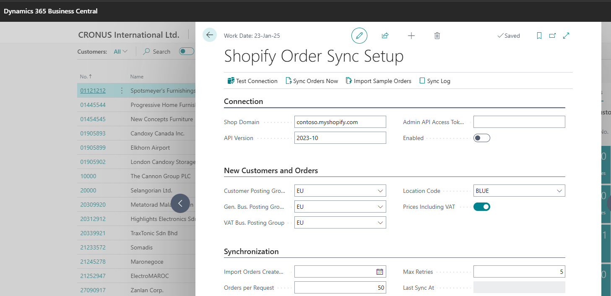
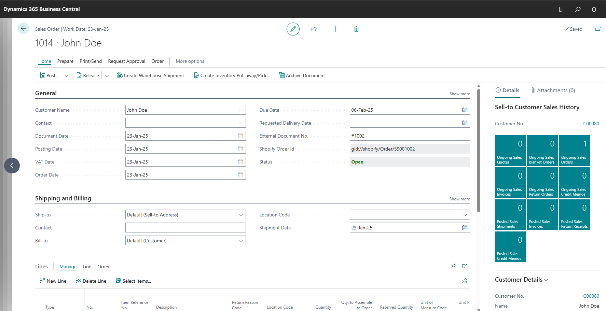

# Shopify Order Sync for Business Central

A small AL extension that imports Shopify orders into Dynamics 365 Business Central as sales orders. It runs on the Job Queue, records every order in a sync log, and keeps going when one order fails.

This is a reference sample. Business Central has Microsoft's own Shopify Connector, and for a standard store you should use that. The sample shows the patterns I use when a client needs a custom integration: a different platform, unusual mapping rules, or logic the standard connector doesn't cover.



## What it does

- Reads orders from the Shopify GraphQL Admin API (2025-10), one page at a time, using cursor pagination.
- Matches customers by e-mail and creates any that are missing, using the posting groups from setup.
- Creates a sales order per Shopify order. Items are matched by SKU, first on Item No. and then on Item Reference.
- Writes each order to a sync log with its status (Pending, Processed, Error or Skipped), its error text and the raw JSON payload.
- Processes each order on its own, so one bad order is logged and the rest still import. Failed orders can be retried from the log.
- Handles Shopify rate limits. It reads `Retry-After` on HTTP 429, retries `THROTTLED` GraphQL errors, and backs off exponentially up to 30 seconds.
- Never imports an order twice. The Shopify order ID is stored on the sales header and checked before a new order is created.
- Stores the access token in Isolated Storage (encrypted when encryption is enabled), never in a table field, and only hands it to the HTTP request as `SecretText`.

## How it works

```
Job Queue ──► FSO Order Sync Job (50103)
                 │
                 ▼
            FSO Order Sync (50101) ── fetch page ──► FSO Shopify API Client (50100) ──► Shopify GraphQL
                 │                                       (429 / THROTTLED retry)
                 │  for each order:
                 │   1. insert Sync Log entry (Pending) + payload, Commit
                 │   2. Codeunit.Run(FSO Process Order, entry)
                 ▼
            FSO Process Order (50102)
              customer ► sales header ► sales lines ► Processed
              any error ► rolled back ► entry set to Error with message
```

The key pattern is `Commit` followed by `Codeunit.Run`. Each order runs inside its own transaction, so a missing item or a bad address rolls back only that order. The error is written to the log instead of stopping the whole batch.

Each sync looks back 10 minutes before the last sync time, so orders created during a previous run are not missed. Orders already in the log are skipped.

## Screenshots

| Setup | Sales order created from Shopify |
|---|---|
|  |  |


## Setup

1. **Create a Shopify custom app.** In Shopify admin, go to *Settings → Apps and sales channels → Develop apps*. Create an app, give it the `read_orders` and `read_customers` Admin API scopes, install it, and copy the Admin API access token.
2. **Install the extension.** Open the folder in VS Code with the AL Language extension, download symbols from a Business Central 23 or later environment, then publish with F5.
3. **Assign permissions.** Give users the `FSO SHOPIFY SYNC` permission set.
4. **Fill in the setup page.** Search for *Shopify Order Sync Setup*. Enter the shop domain (`your-store.myshopify.com`), paste the access token, choose the posting groups and location, and set *Import Orders Created After*.
5. **Test.** Choose **Test Connection**, then **Sync Orders Now**, then check the **Sync Log**.
6. **Schedule it.** Create a Job Queue Entry for codeunit **50103 FSO Order Sync Job**, for example every 15 minutes.

### Trying it without a Shopify store

In a demo company such as CRONUS, fill in the posting groups on the setup page and choose **Import Sample Orders**. It builds three orders in the same format Shopify returns and runs them through the normal import, so real customers and sales orders are created:

- **#1001** and **#1002** use existing items and import as sales orders.
- **#1003** includes SKU `WEB-999`, which does not exist, so it shows as an error in the **Sync Log**. Add an item reference `WEB-999` to any item, then choose **Retry Selected** to import it.

Each run adds three new order numbers, so you can run it again.

## Objects

| Type | ID | Name |
|---|---|---|
| Table | 50100 | FSO Shopify Setup |
| Table | 50101 | FSO Sync Log |
| Page | 50100 | FSO Shopify Setup |
| Page | 50101 | FSO Sync Log |
| Codeunit | 50100 | FSO Shopify API Client |
| Codeunit | 50101 | FSO Order Sync |
| Codeunit | 50102 | FSO Process Order |
| Codeunit | 50103 | FSO Order Sync Job |
| Codeunit | 50104 | FSO Sample Orders |
| Enum | 50100 | FSO Sync Status |
| Table Extension | 50100 | FSO Sales Header (Shopify Order Id) |
| Page Extension | 50100 | FSO Sales Order |
| Permission Set | 50100 | FSO SHOPIFY SYNC |

## Not included

This sample leaves out a few things on purpose, to keep it short:

- Shipping lines, discounts and tax lines
- Refunds and cancellations
- Writing fulfilment status back to Shopify
- Product and inventory sync

These are usually where client-specific rules come in.

## Requirements

- Business Central 23.0 or later (runtime 12.0), Online or On-Premises
- A Shopify store with a custom app and Admin API access

## Licence

MIT. See [LICENSE](LICENSE).

---

Built by Muhammad Fauzan Azam, a Microsoft Certified Business Central developer (MB-820, MB-800). I build custom integrations and extensions through [Dynorbit](https://dynorbit.pages.dev/). [Get in touch](https://dynorbit.pages.dev/contact).
